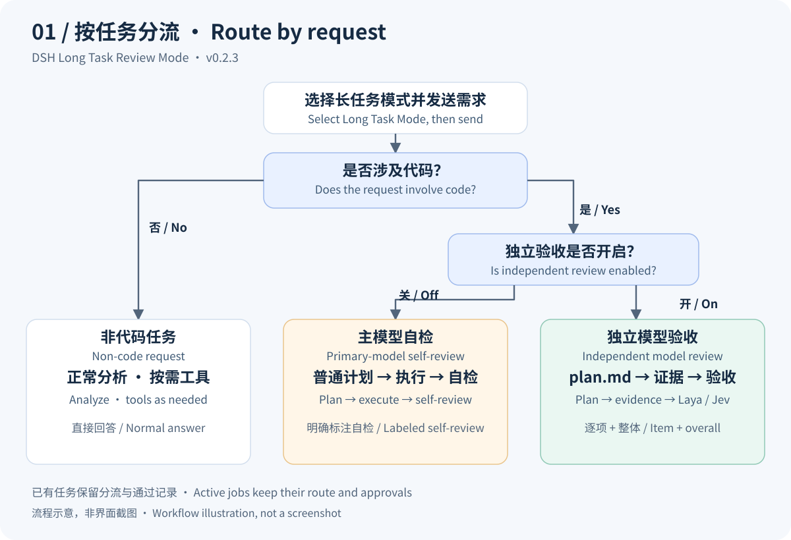
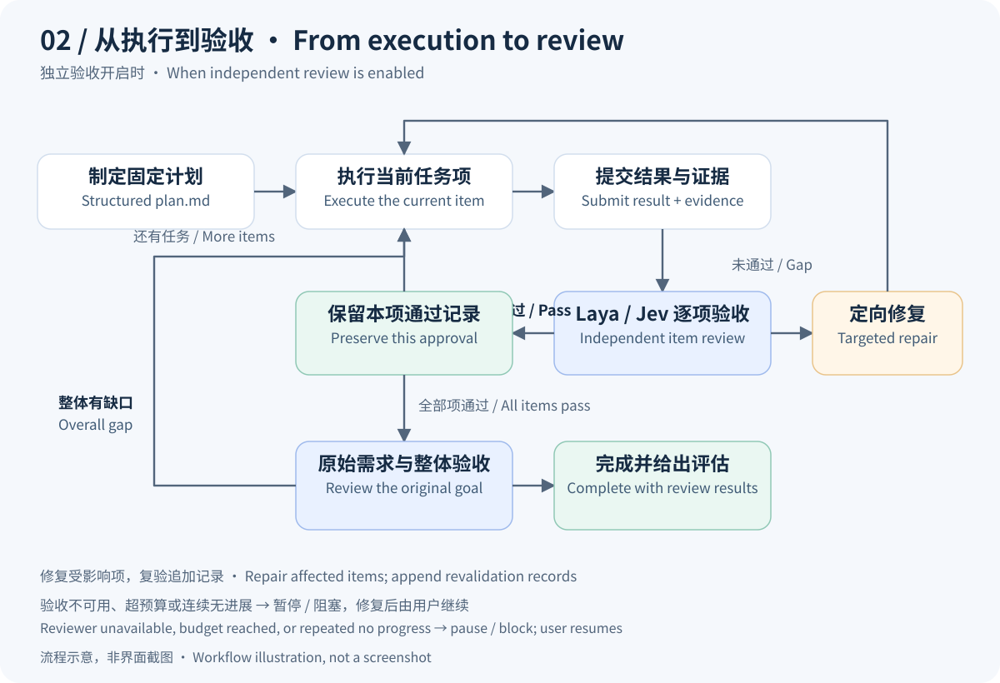

# DSH Long Task Review Mode

[中文](README.md) · [English](README.en.md) · [Download v0.3.0](https://github.com/003jia/dsh-long-task-review-mode/releases/tag/v0.3.0) · [Workflow reference](docs/workflow.en.md)

**Give multi-step coding tasks a plan, evidence, item-by-item review, and a way to resume.**

One DSH plugin combines Claude Loop execution coordination, local **Laya** / cloud **Jev** independent review, a native conversation mode, settings, and a live progress sidebar. The primary model performs the work; a separate model checks it against the plan. Accepted records survive context compaction, continuation, and restart.

Plugin: **0.3.0** · Verified runtimes: **DSH 0.2.1-rc.3 / 0.2.2-alpha.2** · **Apache-2.0**. This is a community extension. Its package name follows existing installations and does not imply official DSH maintenance.

## How it works



*Workflow illustration, not an application screenshot. Implementation, debugging, code reading, and code review count as coding tasks. Routing is based on whether the request involves code, rather than its complexity.*

| Request and setting | Execution | Completion check |
| --- | --- | --- |
| Non-code · direct answer (default) | Analyze, use tools as needed, answer | No mandatory `plan.md` or independent scoring |
| Non-code · plan + self-review | Ordered plan, item by item | Primary-model item and overall self-review; no Laya/Jev calls |
| Non-code · plan + independent review | `plan.md` opinion items, item by item | Independent item and overall review; no execution receipts required |
| Coding request, independent review off | Ordinary plan → execution | Item and overall self-review by the primary model, explicitly labeled |
| Coding request, independent review on | Structured `plan.md` → current item and evidence → Laya/Jev review | Review each item, then the original requirement and overall goal |

The primary model classifies the request; the Host selects the branch from the saved review switch and non-code mode. Independent review is enabled by default. If its reviewer is unavailable, that branch blocks until the connection is repaired. Route, review switch, backend, thresholds, and the non-code mode are fixed per job; global changes apply to new tasks only, and existing tasks keep their configuration and accepted records.

## Features

- **Plan-driven execution**: `plan.md` fixes task IDs, dependencies, deliverables, and acceptance criteria before advancing item by item; tasks may declare `checks` commands that gate scoring deterministically.
- **Preserved evidence and approvals**: accepted results, scores, and evidence remain intact. Changed deliverables require explicit, targeted revalidation; review requests automatically include the latest write receipt and later failures.
- **Optional independent review**: use local Laya or cloud Jev, or turn independent review off for clearly labeled primary-model self-review; non-code work offers direct answer, plan plus self-review, or plan plus independent opinion review.
- **Pause and resume**: durable plugin state preserves the job ID, route, configuration snapshot, and accepted records. After restart, execution waits for the user to continue.
- **Per-job budgets**: new jobs fix tool, assessment, time, token, and optional cost ceilings at creation; running jobs can be extended from the task menu, an 80% warning latches once, and three consecutive no-progress attempts pause.
- **Selectable scope**: Claude Loop mechanisms apply to long-task mode only by default and can be restored to all sessions; ordinary sessions no longer see loop tools.
- **Native integration**: the mode menu, task actions, settings, and live sidebar ship in one package.



*Illustration of the independent-review branch. Repairs target the current item or affected items supported by concrete gap evidence. Accepted facts remain; revalidation appends records. Review and budgets govern task advancement and do not replace an OS sandbox.*

## Install and start

1. Download `deepseek-ai-dsh-long-task-0.3.0.tgz` and `SHA256SUMS` from the [v0.3.0 release](https://github.com/003jia/dsh-long-task-review-mode/releases/tag/v0.3.0). In the download directory, run `shasum -a 256 -c SHA256SUMS`.
2. Back up your DSH profile and wait for active work to finish. Install using the CLI for your deployment:

   ```sh
   # Replace desktop with your profile and use the downloaded file's absolute path.
   dsh plugin --profile desktop add file:/absolute/path/deepseek-ai-dsh-long-task-0.3.0.tgz --config.auto-install-peers=false
   ```

3. Restart DSH. Open **Settings → Long Task Mode → Model Review**, save the review policy, non-code mode, and backend, and validate the connection if independent review is enabled. The **Claude Loop** group adjusts the mechanism scope (long-task mode only by default) and per-turn step budgets.
4. Create an empty conversation, select **Long Task Mode** in the native mode menu, and send your request. The preset is fixed after the conversation starts. Task actions at the top provide pause, continue, end, and new-task controls.

> Host and Client artifacts are included. DSH supplies the shared framework; do not automatically install a second Cordis. The Laya service, model weights, and Python environment are separate prerequisites. Jev requires your own service credentials. The default conversation mode is unchanged.

**Migrating older installations:** preserve your settings and disable old bundles that also advance tasks before enabling `@deepseek-ai/dsh-long-task`. Do not combine it with `@deepseek-ai/dsh-claude-loop-alignment`, `@deepseek-ai/dsh-client-ui-laya`, `@deepseek-ai/dsh-client-ui-loop-flow`, or `@deepseek-ai/dsh-client-ui-settings-claude-loop`. Check your actual profile for older third-party package names.

Example coding request:

> Fix the login error in this project. Inspect the current implementation, create a plan, then implement and test each item with evidence. Preserve accepted items and report both item-level results and the overall conclusion.

The plugin uses your saved review policy. This prompt does not change the backend or toggle independent review.

## Choosing Laya or Jev

| Backend | Prerequisites | Data destination | Validation |
| --- | --- | --- | --- |
| Local Laya (default) | Compatible Laya MCP service, launcher, and model environment | The configured Laya service; processed on-device when deployed locally | Connection and fixed-sample checks in settings |
| Cloud Jev | Full System One endpoint, model, and API key | Requirements, results, and referenced evidence are sent for tasks using this branch | Save, then run “Validate Jev model” |

Jev uses the [TypeSafe System One HTTP protocol](https://docs.typesafe.ai/api/system-one), rather than Chat Completions. DSH's credential service stores the key; settings and tasks retain only a reference. The plugin defaults to local review and does not automatically switch reviewers on failure. Primary-model token/cost budgets exclude Jev service billing.

## What's new in 0.3.0

- **Per-job budgets**: new jobs snapshot ceilings at creation and can be extended while running; an 80% warning latches once. Legacy jobs keep following live settings.
- **Deterministic checks**: `plan.md` tasks may declare `checks` commands; the host runs them before scoring and a failure blocks acceptance without a model call.
- **Three non-code modes**: direct answer (default), plan plus primary self-review, and plan plus independent opinion review (no execution receipts); fixed at job creation.
- **Loop scope**: `loop.scope` defaults to long-task mode only; "all sessions" restores the previous behavior. Ordinary sessions no longer see `snip` / `plan_agent` / `loop_tasks` / `laya_tasks`.
- **Compatibility retained**: the DSH `0.2.2-alpha.2` `undefined.some` fix, step activation conditions, and the rc.3 path are unchanged; upgrades do not reset task history, review policy, or accepted records. The MCP-deferral switch remains inactive on alpha.2 and is labeled in settings.

See the [CHANGELOG](CHANGELOG.md) for release details.

## Validation and development

- New-runtime Loader regressions cover native mode, all three routes, history protection, compaction, cold recovery, and tool-provider visibility. External inference and scoring responses are scripted.
- Native-mode and routing compatibility regressions also pass against the retained rc.3 runtime.
- Real model conversations on the formal DSH alpha.2 desktop succeeded in the previously failing conversation, a new ordinary conversation, and a new long-task conversation. All persisted with `completed` status.
- This compatibility repair did not rerun a full real coding task or live Jev scoring-quality acceptance. CI checks artifact parsing, packaging, and documentation assets; it does not establish model quality.

Building requires a compatible DSH source workspace with dependencies installed and packages built. A standalone `npm install` in this repository is insufficient:

```sh
DSH_SOURCE=/absolute/path/to/built-dsh-workspace node scripts/build.mjs
node --test tests/*.test.mjs
```

Tests default to the formal macOS application. Other deployments can set `DSH_NODE` (a Node/Electron executable supporting that runtime) and `DSH_RUNTIME` (the directory containing `desktop-runtime.json`). Tests use temporary profiles without reading real account credentials or sending real cloud evaluations. See the [English workflow](docs/workflow.en.md) / [中文工作流](docs/workflow.md) for technical details.

## History and license

The repository retains the [original Claude Loop sources](legacy/claude-loop-alignment), [pi-cc-loop-alignment](pi-cc-loop-alignment), [pi-claude-modes](pi-claude-modes), and earlier releases. The main project uses [Apache-2.0](LICENSE); see [THIRD-PARTY-NOTICES.md](THIRD-PARTY-NOTICES.md) for dependencies. The DSH runtime, Laya weights, and Jev service are not distributed with this plugin.
