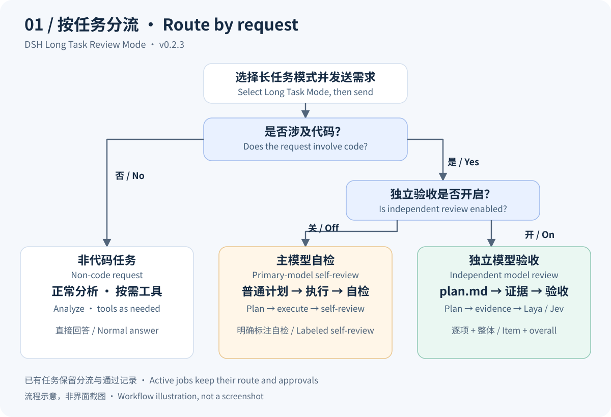
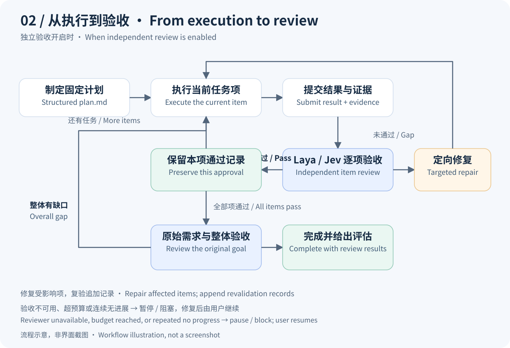

# DSH 长任务自主审查模式

[中文](README.md) · [English](README.en.md) · [下载 v0.2.3](https://github.com/003jia/dsh-long-task-review-mode/releases/tag/v0.2.3) · [详细工作流](docs/workflow.md)

**让多步骤代码任务有计划、有证据、有逐项验收，也能暂停后继续。**

一个 DSH 插件整合 Claude Loop 执行协调、本地 **Laya**／云端 **Jev** 独立验收、原生会话模式、设置页与进度侧栏。主模型负责执行，独立模型按计划检查结果；已有通过记录在上下文压缩、继续和重启后保留。

当前插件：**0.2.3** · 已验证运行时：**DSH 0.2.1-rc.3 / 0.2.2-alpha.2** · **Apache-2.0**。这是社区扩展，包名沿用现有部署；不代表 DSH 官方维护。

## 先看它如何工作



*流程示意，非界面截图。分类依据是是否涉及代码，实现、调试、阅读和代码审查都属于代码任务；不按简单或复杂分流。*

| 任务与设置 | 执行方式 | 完成判断 |
| --- | --- | --- |
| 非代码任务 | 正常分析，按需使用工具并回答 | 不强制 `plan.md`，不调用独立验收 |
| 代码任务，独立验收关闭 | 普通计划 → 执行 | 主模型逐项与整体自检，明确标注自检 |
| 代码任务，独立验收开启 | 固定格式 `plan.md` → 当前项执行与证据 → Laya/Jev 验收 | 逐项通过后，再验收原始需求与整体目标 |

主模型先分类，Host 根据用户保存的开关确定代码分支。独立验收默认开启；模型未连接时，该分支明确阻塞，修复连接后可继续。全局设置只影响新任务，已有任务继续自己的分流、验收后端和阈值。

## 核心能力

- **计划驱动**：`plan.md` 固定任务编号、依赖、交付物与验收标准，当前项完成后再推进。
- **证据与记录保护**：已通过结果、评分和证据保留；交付物变化时显式定位受影响项并追加复验。
- **独立验收可选**：本地 Laya 或云端 Jev；也可关闭独立验收，使用明确标注的主模型自检。
- **可暂停、可恢复**：独立持久状态保留任务 ID、路径、配置快照和通过记录；重启后等待用户继续。
- **预算与停顿规则**：限制工具、评分、时长、主模型 Token 与可选估算费用；默认连续三次无进展暂停。
- **原生入口**：会话模式菜单、顶部任务操作、设置和实时侧栏集中在同一个包中。



*独立验收分支示意。修复只针对当前项或有真实缺口证据的受影响项；通过事实保留，复验追加记录。验收与预算会限制继续推进，但不替代操作系统沙箱。*

## 安装与开始使用

1. 从 [v0.2.3 Release](https://github.com/003jia/dsh-long-task-review-mode/releases/tag/v0.2.3) 下载 `deepseek-ai-dsh-long-task-0.2.3.tgz` 和 `SHA256SUMS`。在下载目录执行 `shasum -a 256 -c SHA256SUMS`。
2. 备份自己的 DSH profile；等待正在执行的任务结束。使用对应部署的 DSH CLI 安装：

   ```sh
   # desktop 可替换为自己的 profile；改成下载包的绝对路径。
   dsh plugin --profile desktop add file:/absolute/path/deepseek-ai-dsh-long-task-0.2.3.tgz --config.auto-install-peers=false
   ```

3. 重启 DSH，进入 **设置 → 长任务模式 → 模型验收**，保存独立验收开关与后端；需要独立验收时先校验连接。
4. 新建空白会话，在原生模式菜单选择 **长任务模式**，再发送需求。开始后预设固定；任务顶部提供暂停、继续、结束和新建操作。

> 安装包已含 Host/Client 产物。DSH 共享框架由运行时提供，不要自动再安装一套 Cordis。Laya 服务、模型权重与 Python 环境需要另行准备；Jev 需要自己的服务凭据。默认会话模式保持原样。

**旧版迁移：** 保留原配置并停用重复推进任务的旧 bundle，再启用 `@deepseek-ai/dsh-long-task`。不可同时组合 `@deepseek-ai/dsh-claude-loop-alignment`、`@deepseek-ai/dsh-client-ui-laya`、`@deepseek-ai/dsh-client-ui-loop-flow` 和 `@deepseek-ai/dsh-client-ui-settings-claude-loop`。第三方历史包名以实际 profile 为准。

可以这样提出代码任务：

> 修复项目中的登录错误。先核对现有实现并创建计划，逐项修改、测试和提交证据。保留已经通过的项目，完成后给出逐项结果和整体结论。

插件会读取已保存的验收策略；这段提示本身不会切换验收后端或修改开关。

## Laya 与 Jev 怎样选择

| 后端 | 需要准备 | 数据去向 | 校验方式 |
| --- | --- | --- | --- |
| 本地 Laya（默认） | 兼容的 Laya MCP 服务、启动器与模型环境 | 发送到已配置的 Laya 服务；本地部署时在本机处理 | 设置页校验连接与固定样例 |
| 云端 Jev | 完整 System One 接口地址、模型和 API 密钥 | 所选云端分支发送需求、结果及引用证据 | 保存后执行“校验 Jev 模型” |

Jev 使用 [TypeSafe System One HTTP 协议](https://docs.typesafe.ai/api/system-one)，不是 Chat Completions 接口。密钥保存在 DSH 凭据服务，配置与任务仅持有引用。默认不主动切到云端；所选后端不可用时不自动换模型。主模型 Token/费用预算不包含 Jev 服务账单。

## 0.2.3 兼容更新

修复 DSH `0.2.2-alpha.2` 新旧会话出现 `Cannot read properties of undefined (reading 'some')` 的问题。新版提示词回调不再包含工具列表；长任务自有工具改用步骤激活条件，普通模式不会带入 `loop_tasks`／`laya_tasks`。

**新版 MCP 声明沿用官方工具提供方的可见性与权限。旧版通过提示词过滤延迟加载 MCP 工具的优化在 alpha.2 上暂不生效，`tool_catalog` 检索保留。** rc.3 保留原接口路径。升级不重置任务历史与通过记录。

详细变更见 [CHANGELOG](CHANGELOG.md)。

## 验证范围与开发

- 新版真实 Loader 回归覆盖原生模式、三路分流、历史保护、压缩、冷恢复与工具权限可见性；外部推理和评分使用脚本化响应。
- rc.3 保留运行时通过原生模式与三路分流兼容回归。
- 正式 DSH alpha.2 已完成真实模型对话验收：原报错会话、新普通会话、新长任务会话均正常回复并持久记录为 `completed`。
- 这次兼容修复未重新跑完整真实代码任务，也未执行真实 Jev 云端评分质量验收。CI 只检查产物解析、打包及文档资源，不代表所有模型效果已验收。

构建需要已安装依赖且构建完成的兼容 DSH 源码工作区，不是独立运行 `npm install` 就能构建的项目：

```sh
DSH_SOURCE=/absolute/path/to/built-dsh-workspace node scripts/build.mjs
node --test tests/*.test.mjs
```

默认测试使用 macOS 正式应用。其他部署可设置 `DSH_NODE`（支持该运行时的 Node/Electron）和 `DSH_RUNTIME`（包含 `desktop-runtime.json` 的目录）。测试使用临时 profile；不会读取真实账号或发送真实云端评分。技术细节见 [中文工作流](docs/workflow.md) / [English workflow](docs/workflow.en.md)。

## 历史与许可证

[原 Claude Loop 源码](legacy/claude-loop-alignment)、[pi-cc-loop-alignment](pi-cc-loop-alignment) 与 [pi-claude-modes](pi-claude-modes) 保留在仓库中，历史发布保留。主项目采用 [Apache-2.0](LICENSE)；依赖声明见 [THIRD-PARTY-NOTICES.md](THIRD-PARTY-NOTICES.md)。DSH 运行时、Laya 模型权重及 Jev 服务不随插件分发。
