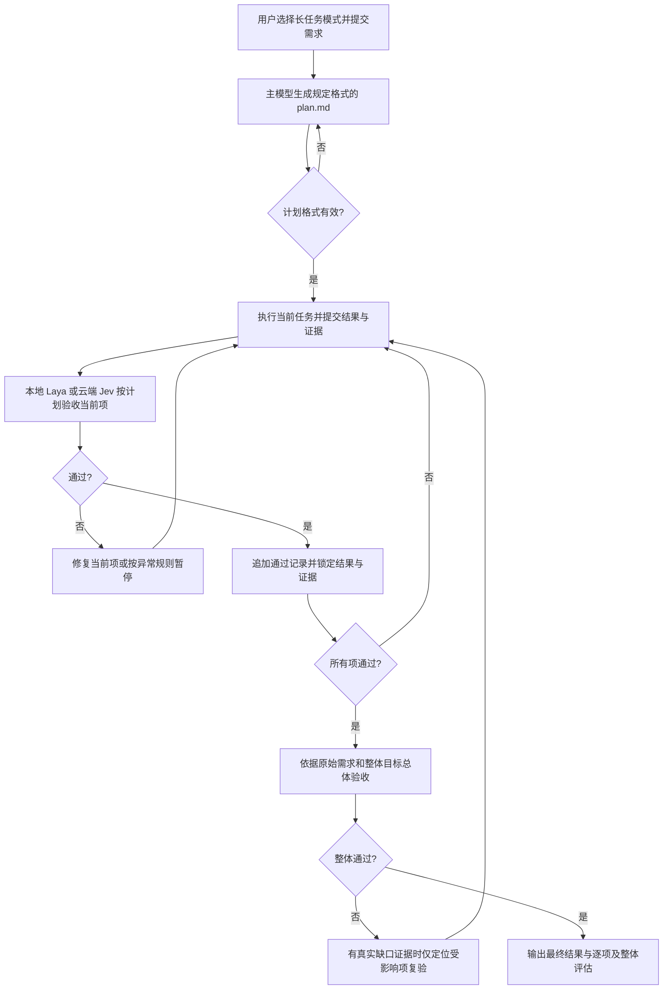

# dsh-长任务自主审查模式

将 Claude Loop 执行协调、本地 Laya / 云端 Jev 验收、设置页与进度侧栏合为一个 DSH 插件。目标运行时：**DSH 0.2.1-rc.3**。当前插件版本：**0.2.1**。

在新建会话的原生模式菜单中选择 **长任务模式**，与标准、PTC、极简、创造模式并列。默认模式不变，首次发送任务才启动；普通会话不显示额外选择条。

## 工作流程



- `plan.md` 包含目标范围、固定任务编号与依赖、完成目标、验收标准、交付物/证据、异常和计划变更规则。
- 每次只提交当前项。已通过项的结果、证据和评分保留，不能在上下文压缩后用摘要改写；真实交付字节变化只触发对应项的显式复验。
- 状态写入独立持久记录，支持暂停、继续和重启恢复。默认连续三次无进展暂停，工具、评分、时长和主模型 Token/费用预算持续累计。
- 设置保留 Claude Loop 四个预设、工具调用项、循环参数与统计；提供本地 Laya 和云端 Jev 配置及样例校验。
- Jev 使用 [TypeSafe System One](https://docs.typesafe.ai/api/system-one) 协议。密钥存入 DSH 凭据服务，普通配置只存引用；默认本地，不自动上传任务。选择云端后会发送该任务的需求、结果与证据。

## 安装

从 [Releases](https://github.com/003jia/dsh-long-task-review-mode/releases/latest) 下载 `deepseek-ai-dsh-long-task-0.2.1.tgz`，核对同页 SHA-256 后安装。先备份 profile，并等待运行中的任务结束再重启。

```sh
# 根据自己的部署选择 desktop 或 web；路径改为下载的绝对路径。
dsh plugin --profile desktop add file:/absolute/path/deepseek-ai-dsh-long-task-0.2.1.tgz --config.auto-install-peers=false
```

包中已包含 Host/Client 产物，不需要安装时构建。DSH 共享框架由运行时提供，不要自动另装一套 Cordis。

迁移旧 Claude Loop/Laya 部署时，先保存原配置，再移除重复推进任务的旧 bundle。当前统一包 ID 为 `@deepseek-ai/dsh-long-task`；不可与 `@deepseek-ai/dsh-claude-loop-alignment`、`@deepseek-ai/dsh-client-ui-laya`、`@deepseek-ai/dsh-client-ui-loop-flow`、`@deepseek-ai/dsh-client-ui-settings-claude-loop` 同时组合。旧版本第三方包 ID 请按实际 profile 核对。

重启后，在设置 → 长任务模式配置验收模型。本地 Laya 需要另行安装兼容的 Laya MCP 服务，模型权重、Python 环境不随本插件发布；填写启动器绝对路径并校验。云端填写完整 System One 地址、模型及 API 密钥，保存后点击校验。模型不可用时明确阻塞，不自动降级或切换。

## 开发与验证

完整行为、配置、持久化与预算说明见 [工作流文档](docs/workflow.md)。构建需要已安装依赖并构建的兼容 DSH 源码工作区，设置 `DSH_SOURCE=/absolute/path/to/dsh` 后执行 `node scripts/build.mjs`。构建工具及共享类型从该工作区读取；不是仅凭本仓库执行 npm install 即可构建的项目。

`node --test tests/*.test.mjs` 使用已安装的正式 DSH Loader、Agent、Gateway、压缩及 JSONL 持久化；macOS 默认从 `/Applications/DeepSeek Harness.app` 解析。其他部署可设置 `DSH_NODE`（支持 ASAR 的 Node/Electron 可执行文件）和 `DSH_RUNTIME`（含 desktop-runtime.json 的 DSH 运行时目录）。测试使用临时 profile，外部推理脚本化，不读取真实账号或发送真实云端评分。

本次三组回归通过，包括七个通过记录保护、真实压缩后继续 T08、跨进程恢复、原生预设选择及 Jev HTTP 边界。正式桌面菜单与本地 Laya 样例已检查；**尚无真实 Jev 云端质量验收，也未完成真实八项任务整体通过验收**。CI 仅检查发布产物可解析/可打包，不能替代桌面和模型验收。

## 原仓库内容与许可证

原 Claude Loop 源码和文档保留在 [legacy/claude-loop-alignment](legacy/claude-loop-alignment)，Git 历史继续保留。[pi-cc-loop-alignment](pi-cc-loop-alignment) 与 [pi-claude-modes](pi-claude-modes) 两个独立 Pi 包保持原样。

主项目沿用原仓库 Apache-2.0 许可证；第三方依赖保留各自许可证，详见 [THIRD-PARTY-NOTICES.md](THIRD-PARTY-NOTICES.md)。Laya 模型权重、Jev 服务及 DSH 运行时不随包分发。
